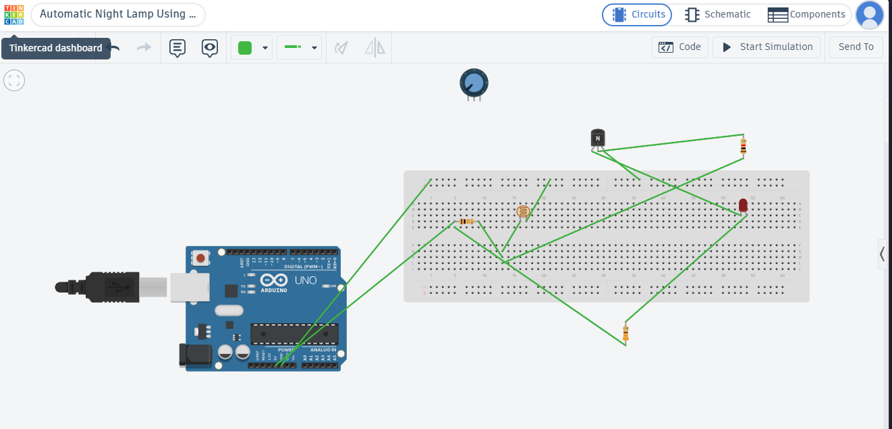
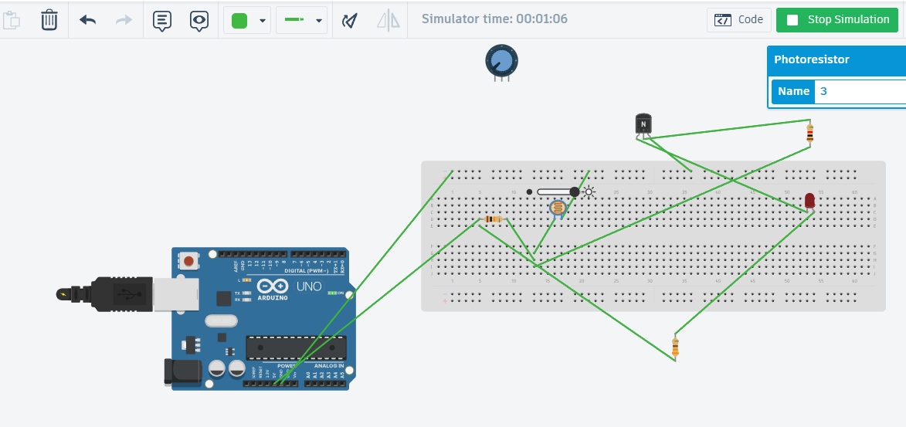
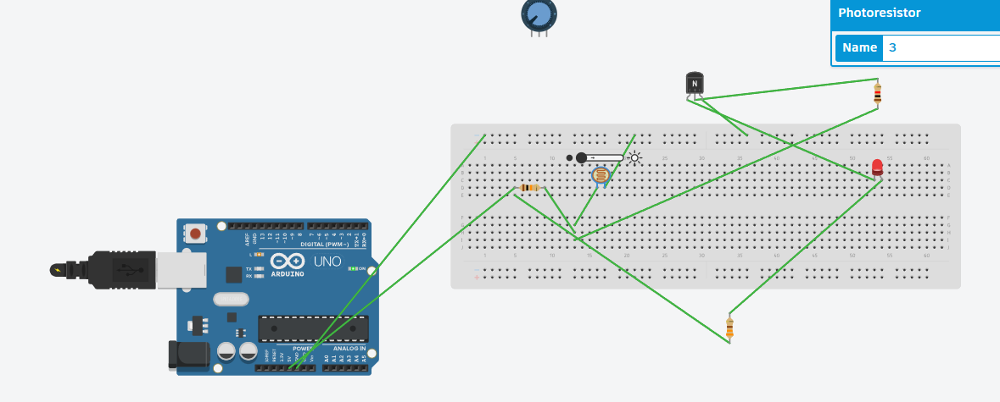

# UNIT_001 // Automatic Night Lamp

> **Objective:** Implement automatic light-dependent LED switching.

## Overview

This project simulates an automatic night lamp using a light-dependent resistor (LDR), an NPN transistor, and an LED in Tinkercad Circuits.

The circuit responds to ambient light levels, switching the LED ON in darkness and OFF in brighter conditions.

## Components

- LDR (photoresistor)
- NPN transistor
- LED
- Resistors
- 5V supply and jumper wires
- Tinkercad Circuits

## Working Principle

The LDR and a fixed resistor form a voltage divider. Changes in light level alter the divider output, controlling the transistor's switching state.

- **Bright conditions:** LED OFF
- **Dark conditions:** LED ON

## Evidence & Verification

The circuit was tested under different simulated light conditions. The wiring remained unchanged; only the LDR light level was adjusted.

## Simulation

**Tinkercad circuit:** [Open the simulation](https://www.tinkercad.com/things/8V9QawkApAe-automatic-night-lamp-using-ldr?sharecode=VLafE9SWGiSJJ5N4Gb10ugw_6s1JNAwwmCBm_fTDFv0)

### 01 — Complete Circuit

*Full circuit showing the LDR, transistor, LED, resistors, and connections.*

### 02 — Bright Conditions

**Expected result:** LED OFF.

The circuit switches the LED off when the simulated ambient light level is high.

### 03 — Dark Conditions

**Expected result:** LED ON.

The circuit switches the LED on when the simulated ambient light level is low.

## Engineering Notes

- **Verification method:** Tinkercad simulation
- **Key concepts:** LDR response, voltage divider, NPN transistor switching, and LED current limiting
- **Current status:** Simulation completed
- **Next improvement:** Test the circuit using physical components.

## Engineering Notes

**Current status:** Simulation completed.

**Key concepts:** Light sensing, voltage dividers, transistor switching, and current limiting.

**Next step:** Document the final circuit, component values, and test results.
