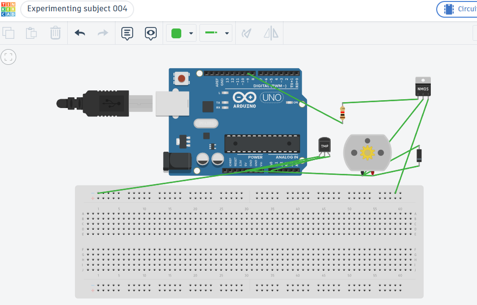
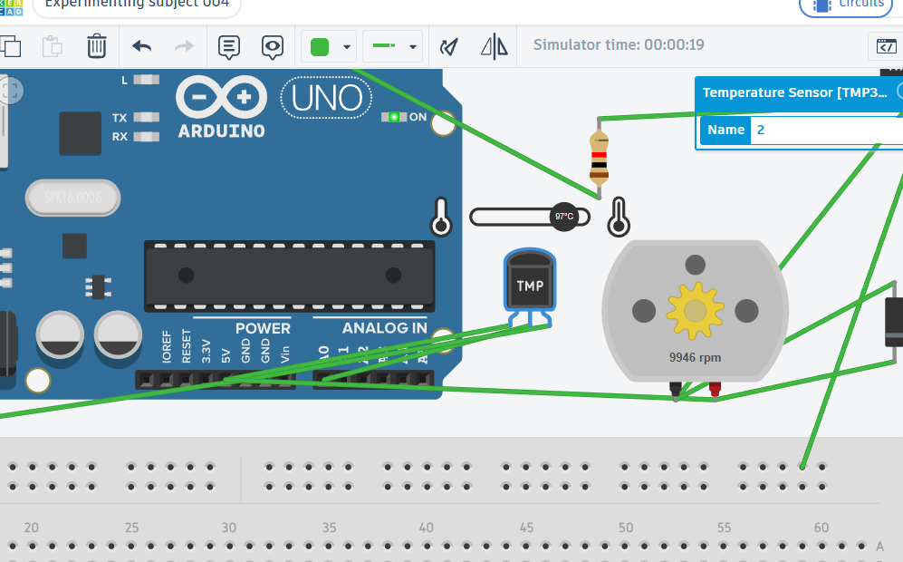

# UNIT_002 // Temperature-Controlled Fan

## Objective

To simulate an automatic cooling system that switches a DC motor on when the measured temperature reaches a predefined threshold.

## Overview

This project uses an Arduino Uno and a TMP36 temperature sensor to monitor temperature. An N-channel MOSFET controls the DC motor, while a diode provides protection against voltage spikes generated by the motor.

## Components

- Arduino Uno
- TMP36 temperature sensor
- DC motor
- N-channel MOSFET
- Diode
- Connecting wires

## Working Principle

1. The TMP36 measures the simulated ambient temperature.
2. The Arduino reads the sensor's analog output through pin A0.
3. The program converts the sensor reading into a temperature value.
4. When the temperature reaches or exceeds 30°C, the Arduino switches the motor ON through the MOSFET.
5. When the temperature falls below 30°C, the motor switches OFF.

## Pin Configuration

| Component | Arduino connection |
|---|---|
| TMP36 output | A0 |
| Motor control | D9 |

## Evidence & Verification

### 01 — Complete Circuit

*Full circuit showing the Arduino, temperature sensor, motor driver, and DC motor.*

### 02 — Temperature Threshold Test

*Simulation evidence showing the fan's response to the temperature threshold.*

## Simulation

**Tinkercad circuit:** [Open the simulation](PASTE_YOUR_TINKERCAD_LINK_HERE)

## Engineering Notes

- **Verification method:** Tinkercad simulation
- **Key concepts:** Analog sensor readings, temperature conversion, conditional logic, MOSFET switching, and motor protection
- **Current status:** Simulation completed
- **Next improvement:** Test the controller with physical components and evaluate its switching threshold.
