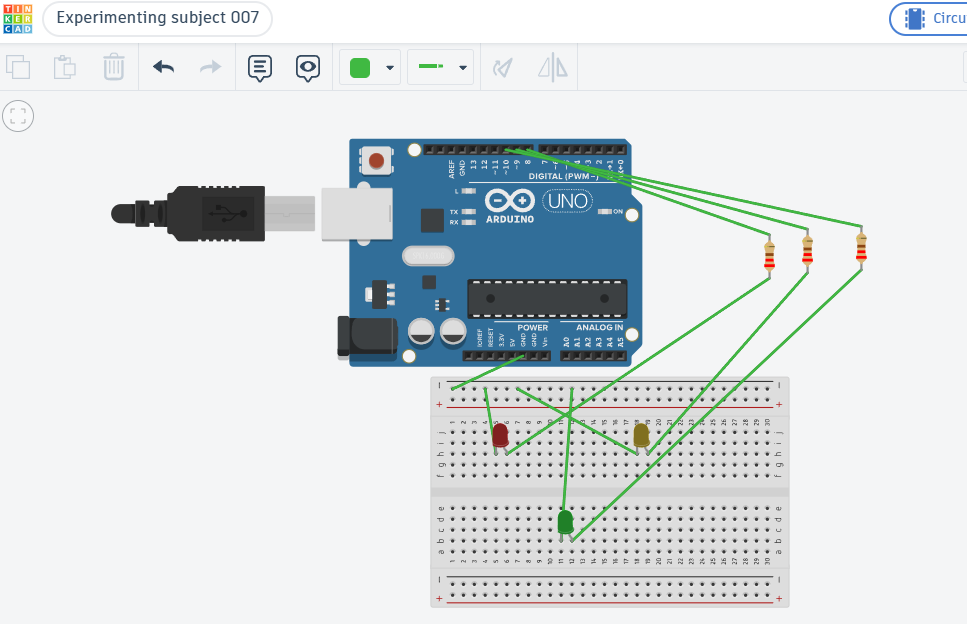
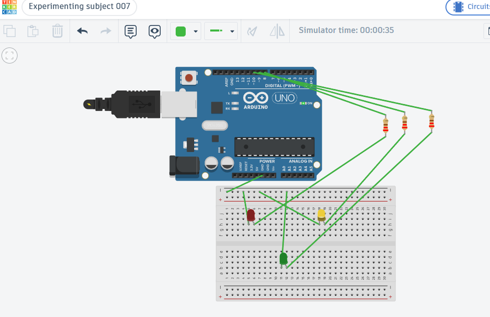

# UNIT_003 // Arduino Traffic Light Controller

## Objective

To simulate a traffic light system using an Arduino Uno, three LEDs, and timed control logic.

## Overview

This project uses an Arduino Uno to control red, yellow, and green LEDs in a repeating sequence that represents a basic traffic signal.

## Components

- Arduino Uno
- Red LED
- Yellow LED
- Green LED
- Three current-limiting resistors
- Connecting wires

## Pin Configuration

| Component | Arduino pin |
|---|---|
| Red LED | D8 |
| Yellow LED | D9 |
| Green LED | D10 |

Each LED is connected through a current-limiting resistor.

## Working Principle

The Arduino executes a repeating sequence:

1. **Red ON** — 5 seconds
2. **Green ON** — 5 seconds
3. **Yellow ON** — 2 seconds
4. The sequence repeats continuously.

The LEDs indicate the active signal, with the other LEDs turned OFF during each stage.

## Evidence & Verification

### 01 — Complete Circuit

*Complete circuit showing the Arduino Uno, three LEDs, and their resistors.*

### 02 — Signal Sequence

*Simulation evidence showing the traffic light controller operating.*

## Simulation

**Tinkercad circuit:** [Open the simulation](https://www.tinkercad.com/things/hGIa6nddFZW-experimenting-subject-007?sharecode=KtqeVm1oH2Y1A837ts6DEt5kCIuVEf01PD_xwbcxRww)

## Engineering Notes

- **Verification method:** Tinkercad simulation
- **Key concepts:** Digital outputs, timing, sequential logic, and LED current limiting
- **Current status:** Simulation completed
- **Next improvement:** Add a pedestrian crossing button and a safe signal transition sequence.
